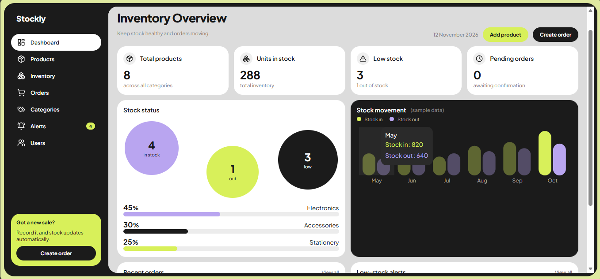
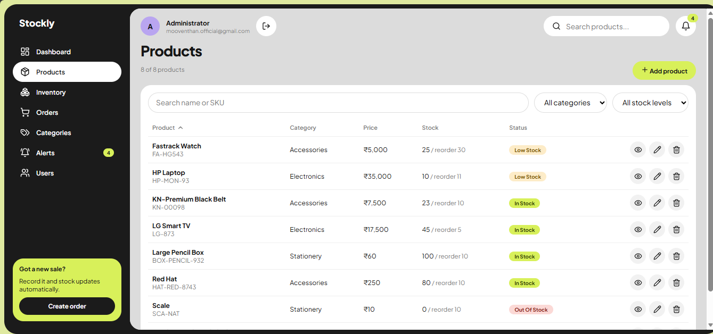
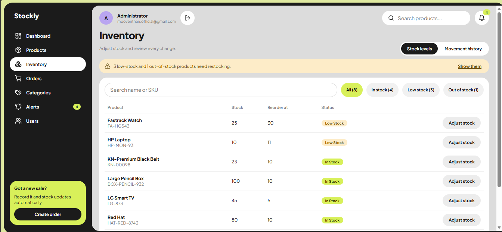
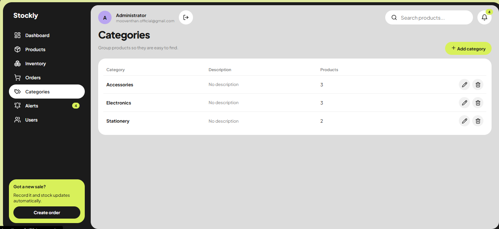
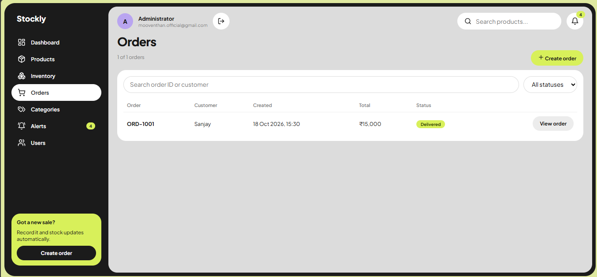
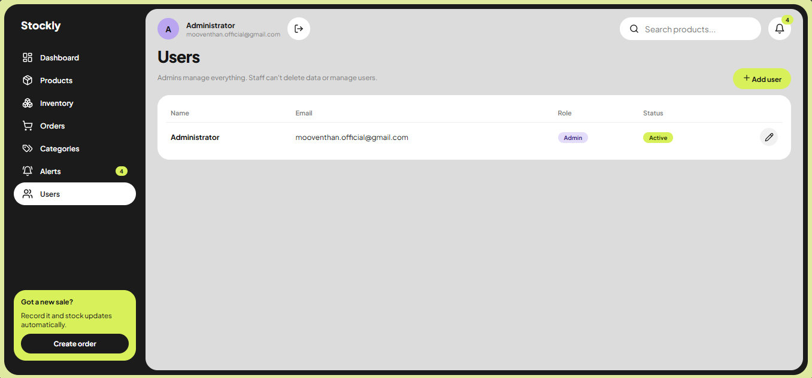
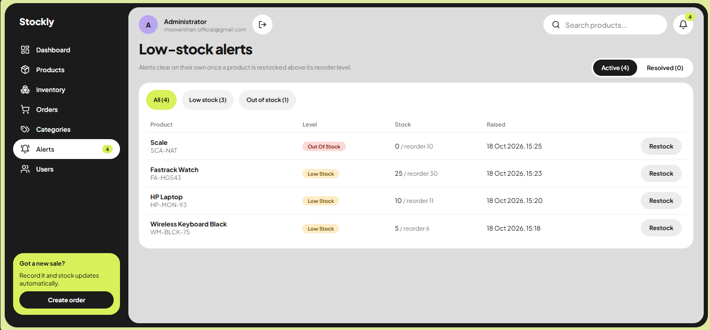
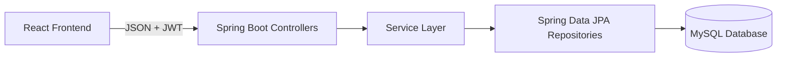

# Stockly – Smart Inventory & Order Management System

A full-stack inventory and order management application built to help businesses manage products, monitor stock levels, process customer orders, and track low-stock alerts through a centralized dashboard.

## Technology Stack

| Layer | Technologies |
|---|---|
| Frontend | React, Vite, React Router, Recharts |
| Backend | Java 21, Spring Boot 3.4 |
| Security | Spring Security, JWT |
| Database | MySQL 8 |
| ORM & Persistence | Spring Data JPA, Hibernate |
| Database Migrations | Flyway |
| Validation | Bean Validation |
| Build Tool | Maven |

## Key Features

- **Dashboard:** Displays inventory totals, recent orders, and low-stock alerts.
- **Product Management:** Search, filter, sort, paginate, add, edit, and delete products with unique SKU validation.
- **Category Management:** Create and manage categories, with deletion blocked when products are assigned to them.
- **Inventory Management:** Perform controlled stock adjustments with reasons and maintain a complete stock movement history. Stock cannot fall below zero.
- **Order Management:** Create multi-item orders, calculate totals on the server, and manage order status transitions.
- **Stock Automation:** Automatically deduct stock when orders are created and restore stock when eligible orders are cancelled.
- **Low-Stock Alerts:** Automatically generate alerts, prevent duplicate open alerts for the same product, and resolve alerts after restocking.
- **Authentication & Authorization:** JWT-based login with ADMIN and STAFF roles enforced by the backend.
- **User Management:** Admin users can manage application users.

## Application Screenshots

### Dashboard


### Products


### Inventory


### Categories


### Orders


### Users


### Alerts


## System Architecture



**Architecture overview:**
- React handles the user interface and communicates with the backend through REST APIs.
- Spring Boot controllers receive and process API requests.
- The service layer handles business rules and transaction management.
- Spring Data JPA repositories communicate with MySQL.
- Flyway manages database schema migrations.

**Additional documentation:**
- [Database Design](backend/docs/database.md)
- [API Reference](backend/docs/API.md)

## Order Workflow

Orders follow this status sequence:

`PENDING → CONFIRMED → SHIPPED → DELIVERED`

Cancellation is allowed from `PENDING` or `CONFIRMED`.

- Stock is deducted when an order is created.
- Database row locking helps prevent concurrent orders from taking more stock than is available.
- Stock is returned when an eligible order is cancelled.
- Every stock adjustment is recorded in the inventory movement history.

## Getting Started

### Prerequisites

Make sure you have installed:

- JDK 21
- MySQL 8
- Node.js 20+
- IntelliJ IDEA (or another Java IDE)
- Maven

### 1. Clone the Repository

```bash
git clone https://github.com/Mooventhan-bytes/Stockly.git
cd Stockly
```

### 2. Configure the Database

Start your MySQL server.

The `smart_inventory` database and its tables are created automatically on first application startup using Flyway migrations.

### 3. Configure and Run the Backend

1. Open the `backend/` folder in IntelliJ IDEA.
2. Configure the environment variables listed in `backend/.env.example` in your run configuration.

Required environment variables:

```env
DB_PASSWORD=your_mysql_password
JWT_SECRET=your_secure_secret_at_least_32_characters
ADMIN_EMAIL=your_admin_email
ADMIN_PASSWORD=your_admin_password
```

3. Run `InventoryApplication.java`.

The backend starts at:

`http://localhost:8080`

### 4. Run the Frontend

Open a terminal inside the `frontend/` folder and execute:

```bash
npm install
npm run dev
```

Open the application in your browser:

`http://localhost:5173`

Sign in using the admin email and password configured in the backend.

### 5. Optional Sample Data

You can execute the following SQL file using MySQL Workbench:

`backend/docs/sample-data.sql`

**Windows Note:** If PowerShell blocks npm scripts, you can use Command Prompt or configure the current user's execution policy:

```powershell
Set-ExecutionPolicy -Scope CurrentUser -ExecutionPolicy RemoteSigned
```

## Testing

**Unit Tests**

Run the following commands from the `backend/` directory:

```bash
mvn test
```

Unit tests do not require a database.

**API Testing**

The project includes an API walkthrough:

`backend/docs/api-tests.http`

You can execute these requests using IntelliJ IDEA's built-in HTTP Client.

## Project Structure

```text
Stockly/
├── backend/
│   ├── src/
│   │   └── main/
│   │       └── resources/
│   │           └── db/
│   │               └── migration/
│   └── docs/
│       ├── database.md
│       ├── API.md
│       ├── api-tests.http
│       └── sample-data.sql
│
├── frontend/
│   └── src/
│       ├── api/
│       ├── auth/
│       ├── components/
│       ├── pages/
│       └── styles/
│
├── Docs/
│   └── ScreenShots/
│
├── .gitignore
└── README.md
```

## Security

- Passwords are stored using BCrypt hashing.
- Application secrets are supplied through environment variables.
- Secrets and credentials should never be committed to Git.
- Backend authorization is enforced on every protected request.
- JWT login tokens are stored in `sessionStorage` and cleared when the browser tab closes.

## Known Limitations & Future Improvements

- Product and order lists currently load the first 100 rows, although the backend supports full pagination.
- Dashboard category distribution and stock movement charts currently use sample data.
- JWT tokens expire after 60 minutes; refresh token functionality is not implemented.
- Customer details are stored directly with orders; a separate Customer table is not implemented.

---

**Developed as a full-stack project using Java, Spring Boot, React, and MySQL.**