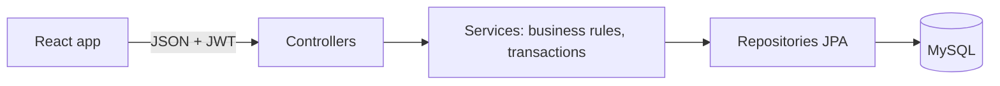

# Stockly: Smart Inventory & Order Management System

A full-stack web app for managing products, stock levels, customer orders and low-stock alerts, with role-based login.

**Stack:** React + Vite, React Router, Recharts | Java 21, Spring Boot 3.4, Spring Security (JWT), Spring Data JPA/Hibernate, Bean Validation | MySQL 8 with Flyway migrations | Maven.

## Features
- Dashboard with live totals, recent orders and low-stock alerts
- Products: search, filter, sort, paginate, add/edit/delete, unique SKU
- Categories: manage, deletion blocked while products use them
- Inventory: controlled stock adjustments with reasons and a full movement history, never below zero
- Orders: multi-item orders, server-calculated totals, status workflow, stock deducted on creation and returned on cancellation, duplicate-submission protection
- Low-stock alerts: raised automatically, one open alert per product, resolved on restock
- Authentication: JWT login, ADMIN and STAFF roles enforced on the server, user management for admins

## Architecture

Details: [database design](backend/docs/database.md), [API reference](backend/docs/API.md).

## Order workflow
PENDING to CONFIRMED to SHIPPED to DELIVERED. CANCELLED is possible from PENDING or CONFIRMED. Stock is deducted when the order is created (rows are locked, so two orders cannot take the last unit) and returned if the order is cancelled. Every stock change is recorded in the movement history.

## Setup
**Prerequisites:** JDK 21, Maven (bundled with IntelliJ), MySQL 8, Node.js 20+.

1. **Database:** start MySQL. The `smart_inventory` database and all tables are created automatically on first start (Flyway).
2. **Backend:** open `backend/` in IntelliJ IDEA. In the run configuration of `InventoryApplication` set the environment variables listed in `backend/.env.example` (`DB_PASSWORD`, `JWT_SECRET`, `ADMIN_EMAIL`, `ADMIN_PASSWORD`). Run it; it listens on http://localhost:8080.
3. **Frontend:** in `frontend/` run `npm install` then `npm run dev`; open http://localhost:5173 and sign in with the admin email and password from step 2.
4. Optional sample data: run `backend/docs/sample-data.sql` in MySQL Workbench.

On Windows PowerShell, if `npm` is blocked, run `Set-ExecutionPolicy -Scope CurrentUser -ExecutionPolicy RemoteSigned` once, or use Command Prompt.

## Tests
- Unit tests: `cd backend` then `mvn test` (no database needed).
- API walkthrough: `backend/docs/api-tests.http` (IntelliJ HTTP Client), with the expected result written above each request.

## Project structure
```
backend/   Spring Boot API (controller, service, repository, entity, dto, security, exception, config)
           src/main/resources/db/migration  Flyway SQL
frontend/  React app (src/api, auth, components, pages, styles)
```

## Security notes
Passwords are stored as BCrypt hashes. Secrets come from environment variables and are never committed. Authorization is enforced by the backend on every request. The login token is kept in `sessionStorage` (cleared when the tab closes).

## Known limitations / future work
- Product and order lists load the first 100 rows (the backend supports full paging)
- Dashboard category split and stock-movement chart use sample data
- Tokens expire after 60 minutes with no refresh
- No separate Customer table (customer details are saved on each order)
