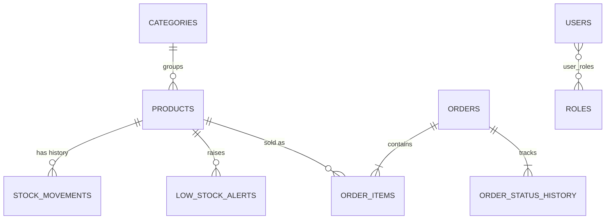

# Database design

MySQL 8, InnoDB, schema owned by Flyway (`src/main/resources/db/migration/V1__create_schema.sql`).
Hibernate does not create or change tables (`ddl-auto: none`); every schema change is a new `V<number>__name.sql` file.

## Entity relationships

## Keys and constraints
| Table | Primary key | Foreign keys | Unique | Other checks |
|---|---|---|---|---|
| categories | id | | name | |
| products | id | category_id | sku | price > 0, stock >= 0, threshold >= 0 |
| stock_movements | id | product_id | | type IN/OUT, quantity > 0, before/after >= 0 |
| low_stock_alerts | id | product_id | active_product_id | open XOR resolved |
| orders | id | | idempotency_key | valid status, total >= 0 |
| order_items | id | order_id (cascade), product_id | (order_id, product_id) | quantity > 0 |
| order_status_history | id | order_id (cascade) | | valid status |
| users / roles / user_roles | id / id / (user_id, role_id) | user_roles -> users, roles | email / name | |

Product and category foreign keys are restrictive: a referenced row cannot be deleted, which backs up the service rules.

## Indexes
`products(name)`, `products(category_id)`, `stock_movements(product_id)`, `stock_movements(created_at)`,
`orders(status)`, `orders(created_at)`, `order_items(product_id)`, `order_status_history(order_id)`, `low_stock_alerts(product_id)`,
plus the unique indexes above. They serve the product search and filters, movement history, order lists by status or date, and joins.

## Decisions
- **Money** is `DECIMAL(12,2)` (never float), mapped to `BigDecimal`.
- **Derived data is not stored.** Stock status (in, low, out) is computed from stock and threshold; order totals are computed once at order time and stored with the order because they are a historical record.
- **Snapshots on purpose.** `order_items` copies the product name, SKU and unit price, and `orders` copies the customer's details, so later edits never rewrite history.
- **One stock number.** `products.stock_quantity` is the current level. It changes only through `InventoryService.apply`, which writes a `stock_movements` row (type, quantity, before, after, reason, time) in the same transaction. Orders write reason `Order ORD-<n>`; cancellations write `Order ORD-<n> cancelled`.
- **Order status** is stored on `orders.status`; every change also adds a row to `order_status_history`. Allowed transitions live in `OrderStatus.canMoveTo`.
- **One open alert per product** is enforced by the database through `active_product_id` (see the schema comment).
- **Concurrency:** products are locked (`SELECT ... FOR UPDATE`, in id order) while an order or adjustment runs, and `version` columns give optimistic locking on products and orders.
- **Idempotency:** `orders.idempotency_key` is unique, so a repeated request cannot create a second order.
